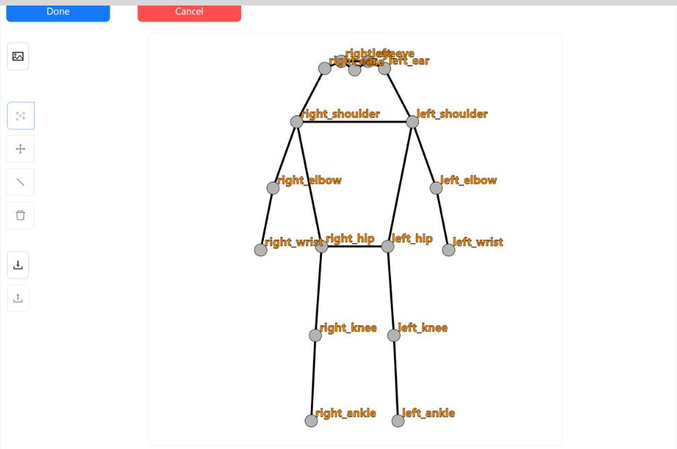
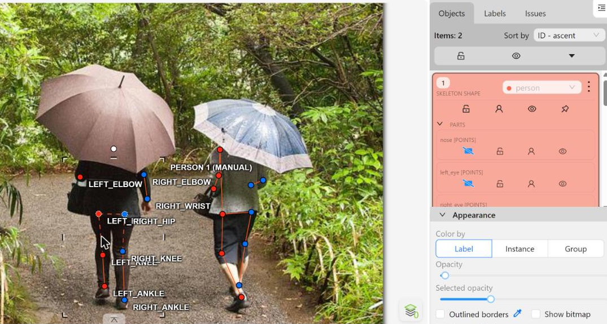
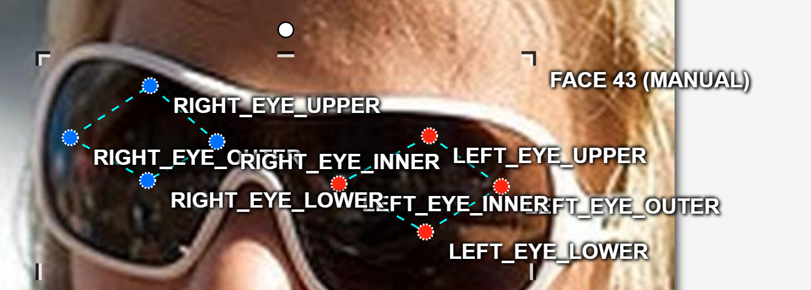
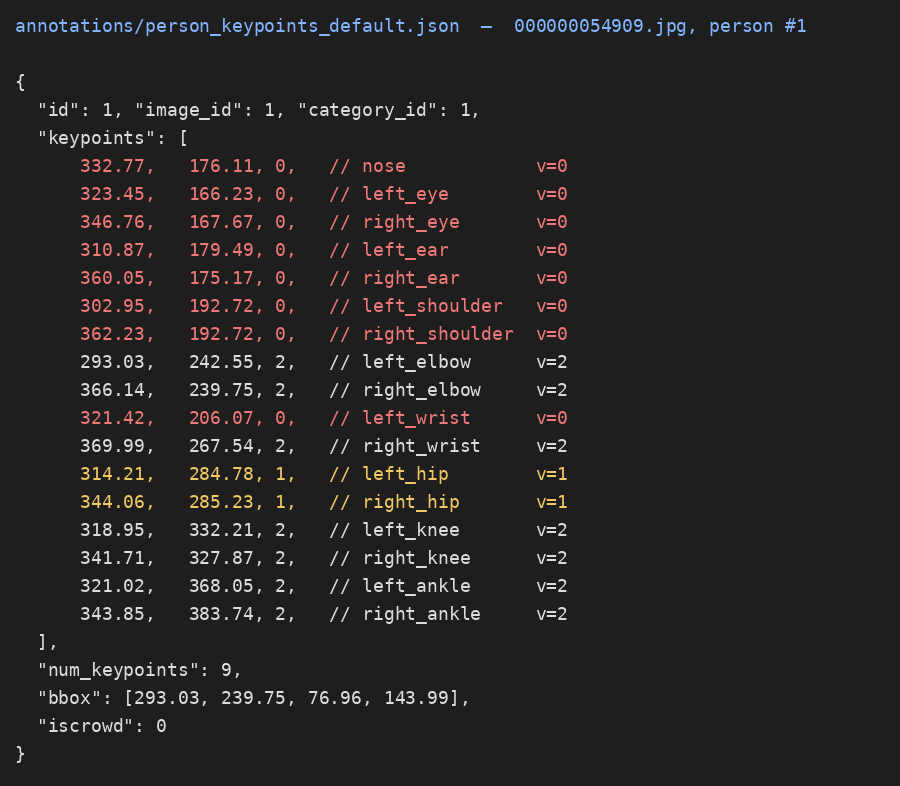

# Báo cáo cá nhân — NguyenDuyKhanh-2A202603055

Dữ liệu: 12 ảnh người COCO 2017 (Lin et al., 2014) và 8 ảnh khuôn mặt cắt từ ảnh COCO 2017 (CC BY / CC BY-SA), chỉ dùng trong lớp.

## 0. Thông tin học viên

- Họ tên: Nguyễn Duy Khánh
- MSSV: 2A202603055
- Email: 26ai.khanhnd5@vinuni.edu.vn
- Link repository: https://github.com/henrykhanh-ai/K5-L2-DAY04-NguyenDuyKhanh-2A202603055-KeypointPose
- Phiên bản CVAT (Help → About): 2.74.1
- Máy: Windows, CVAT chạy trong WSL (Ubuntu) · Docker được dùng 31,2 GB RAM · chạy CVAT chế độ đầy đủ
- Bộ ảnh (`src/exports/assignment.json` do `lab.py setup` tạo): có

## 1. Kiểm tra label (CP0)

| Label | Kiểu | Số điểm | Tên điểm đúng bảng của lab? | Đúng thứ tự? | Số cạnh |
|---|---|---:|---|---|---:|
| `person` | Skeleton | 17 | Có | Có | 19 |
| `face` | Skeleton | 13 | Có | Có | 13 |

Mẫu `person` dựng theo người quay mặt về camera (các điểm `left_*` nằm bên phải khung mẫu)? Có

Cách đổi cờ `occluded` / `outside` cho **một điểm** trên phiên bản CVAT này (một câu):

Mở mục **Parts** của skeleton trong danh sách Objects (hoặc rê chuột vào đúng điểm đó trên ảnh) rồi bật biểu tượng Occluded / Outside của riêng điểm đó; trên ảnh, cạnh nối với điểm `occluded` chuyển sang nét đứt, điểm `outside` bị ẩn.

## 2. Số lượng đã gán và thời gian (CP1, CP2)

| Nhóm ảnh | Số ảnh | Số skeleton đã gán | Số người dưới 60 px (không gán, ước lượng) | Số poster / gương / màn hình bỏ qua | Thời gian (phút) |
|---|---:|---:|---:|---:|---:|
| `easy` | 5 | 6 | 1 | 0 | — |
| `occluded` | 3 | 7 | 0 | 0 | — |
| `back` | 2 | 4 | 0 | 0 | — |
| `small` | 1 | 2 | 7 | 0 | — |
| `crowd` | 1 | 4 | 6 | 0 | — |
| `faces` | 8 | 8 | — | 0 | — |

- Số ảnh người đã xong ở mốc phút 105: — / 10 (không bấm giờ)
- Thời gian thực tế (phút): CP1 — · CP2 — · CP3 — (không bấm giờ từng phần)
- Ảnh tốn thời gian nhất là ảnh nào, vì sao?

...

## 3. Bảng ca khó (CP1, CP2)

Mỗi điểm bạn phân vân một dòng, nhất là phân vân giữa `v = 1` và `v = 0`, hoặc không chắc hướng người.

Tôi không bị phân vân giữa `occluded` và `outside`, vì tôi phân biệt hai cờ theo một nguyên tắc rõ: `occluded` (`v = 1`) là điểm vẫn nằm trong khung hình nhưng bị vật cản che, vẫn ước lượng được vị trí từ các phần còn thấy; `outside` (`v = 0`) là điểm nằm ngoài khung hình hoặc ngoài vùng quan sát, không có cơ sở để đoán vị trí. Những chỗ tôi thật sự phân vân là **vị trí** điểm, không phải cờ:

| Ảnh | Người / mặt | Điểm | Cờ đã chọn | Phân vân giữa | Lý do chọn |
|---|---|---|---:|---|---|
| face_68290 (bonus B2) | mặt có râu | `lip_lower`, `lip_upper` | 2 | vị trí mép môi | râu che viền môi, đặt theo chỗ môi trên và môi dưới gặp nhau |
| các ảnh mặt | mặt thẳng / nghiêng | `*_eye_upper`, `*_eye_lower` | 2 | vị trí mép mí | mí mắt chỉ rộng vài pixel, phóng to rồi đặt giữa mép mí, không đặt ở lông mi |
| 000000508269, 000000326480, 000000253584 | người ở xa, mờ | các điểm trên mặt | | `v = 2` hay `v = 1` | mặt mờ, nhòe hoặc bị che tầm nhìn |
| 000000393909 | người nằm ngang | các khớp tay, chân | | trái hay phải | tư thế nằm làm khó phân biệt vị trí các khớp |

## 4. Bảng tự review (CP3)

Đi từ ảnh cuối về ảnh đầu. 5 ảnh người (ít nhất 2 ảnh `back` hoặc `crowd`) và 3 ảnh mặt. Ít nhất 8 dòng, kể cả dòng `ok`. Ghi lỗi trước, sửa sau.

Mã lỗi dùng đúng một trong: `lr_swap`, `vis_flag`, `position`, `missing`, `extra`, `ok`.

| Ảnh | Người / mặt | Điểm | Mã lỗi | Ghi chú | Đã sửa? |
|---|---|---|---|---|---|
| 000000326480 | người ở mép trái ảnh | cả người | `missing` | người cao trên 60 px bị bỏ sót | Có, đã thêm skeleton |
| 000000253584 | người ở mép trái ảnh | cả người | `extra` | người chỉ cao 56 px (dưới 60 px) và bị gán như quay lưng dù thấy rõ mặt | Có, đã xóa |
| 000000455536 | #2 (chỉ thấy gối và giày ở mép trái) | đầu, vai, tay, hông, chân phải | `vis_flag` | phần lớn người nằm ngoài khung nhưng các điểm bị dồn về mép ảnh với `v = 2`; cổ chân thấy được ở chiếc giày nên không phải `outside` | Có: giữ gối và cổ chân trái `v = 2`, 15 điểm còn lại chuyển `outside` |
| 000000393909 | skeleton thứ hai | cả skeleton | `extra` | skeleton thừa, không ứng với người thật | Có, đã xóa |
| 000000326480 | người nhỏ phía sau | cả người | `extra` | người chỉ cao 20 px, dưới ngưỡng 60 px | Có, đã xóa |
| 000000292999 | #1 | `right_eye`, `right_ear` | `position` | hai điểm đặt đổi chỗ cho nhau | Có, đã đổi lại vị trí |
| face_296767 | kính râm | 8 điểm mắt | `vis_flag` | kính râm tối, mắt sau tròng kính phải là `occluded` | Có, chuyển sang `occluded` |
| face_10579 | mặt thẳng | — | `ok` | | — |
| face_145751 | mặt thẳng | — | `ok` | | — |

Tổng hợp số lỗi theo mã:

| `lr_swap` | `vis_flag` | `position` | `missing` | `extra` | `ok` |
|---:|---:|---:|---:|---:|---:|
| 0 | 2 | 1 | 1 | 3 | 2 |

Điểm còn phân vân giữa `v = 1` và `v = 0` (ghi cả hai lựa chọn và lý do chọn):

Không có. Tôi chọn `v = 1` khi điểm còn trong khung và ước lượng được từ phần còn thấy, `v = 0` khi điểm ra ngoài khung hoặc không có cơ sở đoán.

## 5. Kiểm file xuất và kết quả tự kiểm (CP4)

Tự kiểm tay trong file JSON:

| File | Người / mặt kiểm (ảnh, thứ tự) | Số phần tử `keypoints` | Điểm `outside` ra `v = 0`, `occluded` ra `v = 1`? | `num_keypoints` khớp? |
|---|---|---:|---|---|
| `NguyenDuyKhanh_persons.zip` | 000000054909, người #1 (quay lưng) | 51 | Có: 8 điểm `outside` → `v = 0`, 2 điểm hông `occluded` → `v = 1` | Có (9 = 7 điểm `v = 2` + 2 điểm `v = 1`) |
| `NguyenDuyKhanh_persons.zip` | 000000455536, người #2 (chỉ thấy gối và giày ở mép trái) | 51 | Có: 15 điểm `outside` → `v = 0`, gối và cổ chân trái `v = 2` | Có (2) |
| `NguyenDuyKhanh_faces.zip` | face_296767 (kính râm) | 39 | Có: 8 điểm mắt `occluded` → `v = 1` | Có (13) |

Sau khi xuất, CVAT ghi `occluded` thành `v = 1` và `outside` thành `v = 0`. Tọa độ của điểm `outside` trong file là `0, 0` hay tọa độ cũ? Tọa độ cũ (CVAT 2.x giữ nguyên vị trí điểm; script tự kiểm cũng ghi chú điều này).

Hai job đã chuyển sang completed trên CVAT? Có

Dán phần **TÓM TẮT** in ra từ `src/check_submission.py`:

```text
----- TÓM TẮT (dán vào báo cáo mục 5) -----
- File person: NguyenDuyKhanh_persons.zip
  Số ảnh: 12 · số skeleton `person`: 23 · mỗi annotation 51 số
  Skeleton theo ảnh: 000000054909=2, 000000078170=2, 000000150500=1, 000000253584=2, 000000292999=1, 000000294329=1, 000000326480=4, 000000393909=2, 000000455536=2, 000000461389=3, 000000508269=1, 000000515309=2
  Cờ v: v=2 285 (73%) · v=1 14 (4%) · v=0 92 (24%)
  num_keypoints trung bình: 13.0
- File face: NguyenDuyKhanh_faces.zip
  Số ảnh: 8 · số skeleton `face`: 8 · mỗi annotation 39 số
  Skeleton theo ảnh: face_10579=1, face_145751=1, face_168953=1, face_296767=1, face_300399=1, face_416730=1, face_476363=1, face_79367=1
  Cờ v: v=2 96 (92%) · v=1 8 (8%) · v=0 0 (0%)
  num_keypoints trung bình: 13.0
- Ghi chú: 92 điểm v = 0 vẫn mang tọa độ cũ (CVAT 2.x xuất như vậy; chuẩn COCO ghi 0, 0). Không phải lỗi: điểm v = 0 bị bỏ qua khi huấn luyện và khi chấm.
- Số [LỖI]: 0 · số [CẢNH BÁO]: 4
Kết quả: ĐẠT (đọc lại từng cảnh báo ở trên)
```

Các `[CẢNH BÁO]` còn giữ nguyên và lý do:

- `000000292999 #1`, cặp elbow ngược phía: người cầm gậy bóng chày, hai tay bắt chéo trước ngực thật; đã đối chiếu từng khớp, giữ nguyên.
- `000000508269 #1`, cặp knee, ankle ngược phía: người chơi tennis đang bước, hai chân bắt chéo thật; giữ nguyên.
- `000000326480 #1` (các điểm trải 50 px): người đứng sát mép trái ảnh, thân bị cắt và che một phần, chiều cao thật trên 60 px nên giữ lại.
- `000000253584 #1` (các điểm trải 56 px): người ở xa, sát ngưỡng 60 px; giữ lại.

## 6. Ảnh chụp màn hình

1. Label `person` trong label constructor (đủ 17 điểm có tên):

   

2. Một người quay lưng đã gán, cờ đã đặt (000000054909, người #1: hai hông `occluded` vẽ nét đứt, đầu và vai `outside` bị ẩn):

   

   Nguồn ảnh: COCO 2017.

3. Một khuôn mặt đã gán 13 điểm, phóng to vùng mắt (face_296767, kính râm: 8 điểm mắt `occluded`):

   

   Nguồn ảnh: COCO 2017 (ảnh cắt quanh mặt).

4. Một đoạn JSON xuất của một người (000000054909, người #1; cột chú thích tên điểm và màu thêm vào cho dễ đọc, không có trong file):

   

## 7. Tự đánh giá

1. Lỗi bạn mắc nhiều nhất hôm nay, và cách bạn sẽ tránh ở dự án thật:

   Tôi sai nhiều nhất ở việc xác định mí mắt trên, mí mắt dưới và môi trên, môi dưới. Ảnh có râu làm tôi không xác định được viền môi. Ngoài ra người ở xa, mặt bị che tầm nhìn hoặc mờ nhòe, và người nằm ngang cũng khó phân biệt các vị trí. Ở dự án thật tôi sẽ phóng to tối đa trước khi đặt điểm mặt, và ghi riêng các ảnh mờ, ảnh có râu, ảnh người nằm vào danh sách ca khó để xem lại.

2. Một quy tắc bạn đề xuất thêm vào guideline (kèm ảnh ví dụ nếu có):

   Với mặt có râu hoặc ria che viền môi: đặt `lip_upper` / `lip_lower` tại điểm giữa khe môi theo đường hai môi khép lại, nếu không thấy được khe môi thì để `occluded` (`v = 1`) thay vì đoán vị trí với `v = 2`. Với người nằm ngang: xác định trái/phải bằng cách xoay ảnh trong đầu về tư thế đứng trước khi gán, và kiểm lại bằng đường nối vai–hông–gối không bắt chéo.

3. Nhãn của bạn đi vào model ở đâu? Chọn một lỗi bạn đã sửa và nói nó sẽ làm model học sai thế nào (heatmap, trọng số trong loss, hay bước lật ảnh):

   Tôi chọn lỗi đổi chỗ `right_eye` và `right_ear` ở ảnh 000000292999. Mỗi điểm `v > 0` thành một đỉnh heatmap, nên model sẽ học sai về cấu trúc không gian: đỉnh heatmap "mắt phải" nằm ở vị trí tai và ngược lại. Model nhận diện nhầm đặc trưng, gán nhãn "mắt" cho hình dạng của tai. Vì cả hai điểm đều `v = 2`, lỗi này được tính đủ trọng số trong loss chứ không bị bỏ qua. Khi lật ảnh để tăng dữ liệu, cặp trái/phải được đổi tên theo nhãn sai nên lỗi bị nhân đôi. Cuối cùng các tác vụ phụ thuộc vào vị trí mắt, như ước lượng hướng đầu hay căn chỉnh khuôn mặt, cũng bị sai theo.

## 8. Khó khăn và lỗi kỹ thuật

- **12/11, khoảng 16:53: `python lab.py check` và `python lab.py setup` dừng với lỗi `NotADirectoryError: [WinError 267] The directory name is invalid`** ở bước 4 (sửa lỗi kẹt "Connecting..." do Nuclio). Nguyên nhân: CVAT của tôi cài trong WSL (thư mục `/home/henryk/cvat-day2`) nhưng Docker được gọi trực tiếp từ Windows, nên hàm `shell_in_dir` dùng đường dẫn Linux làm thư mục làm việc trên Windows. Xử lý: chạy `python lab.py check --no-persist` (chỉ sửa tạm qua `docker exec`) và `python lab.py setup --mssv 2A202603055 --ten NguyenDuyKhanh --skip-check`; tạo project và hai task thành công. Đề xuất: `lab.py` nên dùng `wsl -e sh -c` khi thư mục compose là đường dẫn WSL.
- CVAT trên máy là bản 2.74.1, tài liệu lab viết cho bản 2.82; tên một số menu có thể khác.

## Bonus (nếu làm)

### B1 — 3 ảnh người khó thêm

| Ảnh | Số skeleton | Số người dưới 60 px | Ca khó nhất |
|---|---:|---:|---|
| 000000337458.jpg | 3 | 0 | người #2: 6 điểm bị che (`v = 1`) và 5 điểm không thấy (`v = 0`) |
| 000000517702.jpg | 3 | 0 | người #3: bị cắt khung, 10 điểm `outside`, chỉ còn 7 điểm |
| 000000565600.jpg | 3 | 0 | người #2: gần như bị che hết, 9 điểm `v = 0`, 7 điểm `v = 1`, chỉ 1 điểm thấy rõ |

Kết quả `src/check_submission.py` cho `NguyenDuyKhanh_bonus_persons.zip`:

```text
- File person: NguyenDuyKhanh_bonus_persons.zip
  Số ảnh: 3 · số skeleton `person`: 9 · mỗi annotation 51 số
  Skeleton theo ảnh: 000000337458=3, 000000517702=3, 000000565600=3
  Cờ v: v=2 82 (54%) · v=1 24 (16%) · v=0 47 (31%)
  num_keypoints trung bình: 11.8
- Số [LỖI]: 0 · số [CẢNH BÁO]: 0
Kết quả: ĐẠT
```

### B2 — 5 ảnh khuôn mặt đen trắng / hồng ngoại

Kết quả tự kiểm `NguyenDuyKhanh_bonus_faces.zip`: 5 ảnh, 5 skeleton `face`, 39 số mỗi annotation, cờ v: v=2 61 · v=1 2 · v=0 2; 0 lỗi, 0 cảnh báo, ĐẠT.

Ảnh không màu khó hơn ở điểm nào? Kính râm trên ảnh hồng ngoại có còn là `v = 1` không?

Ảnh đen trắng mất độ tương phản màu giữa môi và da, giữa lòng trắng mắt và mí, nên khó thấy đúng mép môi và mép mí hơn ảnh màu. Ca khó nhất là face_68290: râu che viền môi, tôi phải đặt `lip_upper` / `lip_lower` theo khe môi chứ không theo màu môi. Với kính râm trên ảnh hồng ngoại thì không phải lúc nào cũng là `v = 1`: nhiều loại tròng kính tối cho tia hồng ngoại đi qua, nên camera hồng ngoại vẫn thấy được mắt. Nếu nhìn thấy mắt qua tròng kính thì để `v = 2`; chỉ khi tròng kính vẫn tối, không thấy mắt nhưng ước lượng được theo gọng kính thì mới để `v = 1`.

### B3 — Model so với nhãn của tôi (không tính điểm)

Không làm.

## 9. Tài liệu tham khảo và công cụ AI đã dùng

- Tài liệu của lab: `docs/GUIDELINE.md`, `docs/CVAT_CHEATSHEET.md`, `docs/COCO_KEYPOINTS.md`, `docs/HUONG_DAN_BANG_HINH.md`.
- Dữ liệu: COCO 2017 (Lin et al., 2014), CC BY / CC BY-SA.
- **Claude (Anthropic)**, dùng để: tóm tắt yêu cầu bài lab; xử lý lỗi `lab.py` (WinError 267); giải thích quy tắc trái/phải, cờ visibility, OKS; điền các mục thông tin 0, 1, 2 (số skeleton), 5, 6, 8 và dữ liệu bonus của báo cáo; chụp ảnh màn hình mục 6.
- **Model pose:** YOLO26x (phát hiện người) + ViTPose-B (17 điểm), chạy cục bộ, dùng để sinh điểm khởi tạo cho các ảnh người tôi chưa gán xong trong bộ chính và 3 ảnh bonus B1, kể cả thêm lại 2 người bị thiếu ở 000000326480 và 000000253584. Sau đó tôi rà lại trên CVAT. Model cũng được dùng để đối chiếu, tìm lỗi trái/phải và cờ trong các ảnh tôi tự gán. Các ảnh 000000515309, 000000508269, 000000461389, 000000455536, 000000393909 do tôi gán tay. Mục 3, 4, 7 do tôi tự viết.
